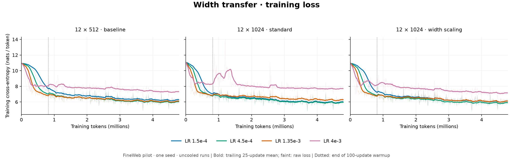
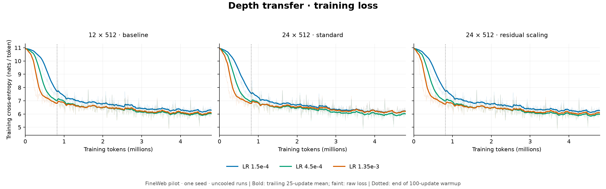
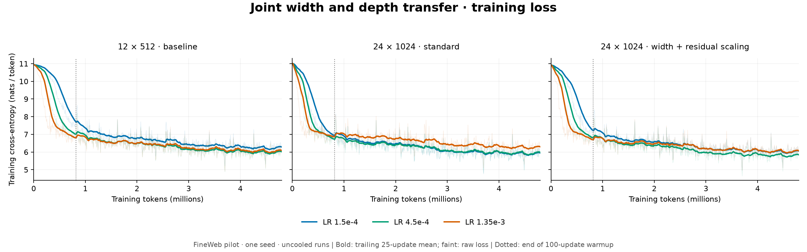

# Scaling status and measurements

Living document (Claude). All numbers were measured on one RTX 5000 Ada 32 GB, torch 2.14.1 / CUDA 13.0 /
Triton 3.8.0, BF16 autocast with FP32 params and optimizer state, full fwd+bwd+AdamW steps after warmup,
synthetic tokens with ~300-token documents. Re-measure on the target hardware before budgeting.

## Components
| Component | Where | Verified by |
| --- | --- | --- |
| Tiled polynomial attention fwd+bwd (3 variants, docs, padding, coef/b grads, document tile skipping) | `tnlm/kernels/poly_attn.py` | `tests/test_kernels.py` vs FP64 dense reference; FP32 rel < 2e-4, BF16 < 3e-2 |
| Chunked exact linear cross-entropy (no full logits) | `tnlm/kernels/fused_ce.py` | `test_math`, Codex's `test_scaling_loss` |
| Per-block activation checkpointing | `ModelConfig.activation_checkpointing` | exact grads in `test_math`; resume replay in `test_scaling_train` |
| Softmax control fast path (FlexAttention, causal+doc block mask) | `attention.softmax_attention_flex` | `test_kernels` vs dense SDPA |
| Muon (torch.optim.Muon) + AdamW split | `tnlm/optim.py` | `tests/test_optim.py` (exact resume) |
| FSDP2 sharding, loss-normalization contract, replicated lagged/spectral state | `tnlm/parallel.py` | `tests/test_parallel.py` (2-rank gloo == 1 process, <= 2e-13) |
| Shape presets 100M → 32B, memory planner | `tnlm/shapes.py` | `tests/test_shapes.py`; planner validated on 1.4B (below) |
| Width coordinate check, empirical width scaling | `tnlm/coordcheck.py`, `ModelConfig.width_scaling_base` | below |

## Throughput (compiled, Triton/Flex fast paths)
| Model | Context | Polynomial tok/s | Softmax control tok/s | Ratio | Poly peak GB |
| --- | --- | ---: | ---: | ---: | ---: |
| 100M (12×512) | 512 | 99.5k | 135k | 0.74 | 5.3 |
| 500M (24×1024) | 2048 | 23.6k | 32.0k | 0.74 | 17.7 |

The kernel alone is 14–38× faster than the dense FP32 reference. Document tile skipping gives a further
1.7× at T=2048 with 300-token docs.

**Where the remaining gap is** (100M, compiled, CUDA time per step; reproduce with `tnlm profile --kernels`):
the polynomial step takes 83 ms vs 62 ms for the control. GEMMs (26 ms vs 27 ms), compiled elementwise
(~29 ms vs 27 ms) and Adam (6 ms) are about equal. The difference is attention: poly fwd 3.8 + bwd_kv 10.4 +
bwd_q 7.5 = 21.7 ms vs ~3 ms for Flex softmax. The polynomial backward runs 11 tile matmuls across its two
kernels (S1, S2 and dP are recomputed in both), against about 5 for a FlashAttention-2-style softmax backward.
**Tried and rejected:** a single fused backward with atomic FP32 dQ (8 instead of 11 matmuls per tile) was
measured **slower**: 0.76× at T=512, 0.48× at T=2048, 0.13× at T=4096/hd128 (`deterministic` vs fused, interleaved
on a shared GPU). Atomic traffic grows as key-blocks × query-blocks × tile and dominates the saved recomputation. Removed.
The two-kernel path stays (it's also bitwise deterministic). Standalone microbenchmarks (about 1.07 ms/layer fwd+bwd) run faster
than in-model (about 1.8 ms/layer); sustained-load clocks on this power-limited card are the likely cause.
Always benchmark full steps.

## Memory planner check
`pilot_1b` (1.41B, head dim 128, checkpointing, chunked CE), 4096 tokens/microbatch on one GPU:
measured peak 22.7 GB vs planner 26.8 GB. The planner is about 15% conservative.

| Preset | Params | Min 80 GB GPUs (ckpt, 8K tok/GPU) | GB/GPU |
| --- | ---: | ---: | ---: |
| pilot_1b | 1.41B | 1 | 33 |
| pilot_3b | 2.81B | 1 | 58 |
| funded_7b | 6.91B | 2 | 73 |
| funded_32b | 34.4B | 16 | 69 |

Those are memory minimums. Throughput targets will need more GPUs.

## Width transfer (coordinate check)
Log-log slope vs width of the RMS change after 20 AdamW steps (lr 4.5e-4), 4 layers, head dim 64,
widths 256–2048, learnable repeat task:

| Parameterization | resid0 | resid3 | attn3 | mlp3 | logits | logits at init |
| --- | ---: | ---: | ---: | ---: | ---: | ---: |
| explicit conventional (default) | +0.57 | +0.54 | +0.48 | +0.49 | +0.90 | +0.50 |
| textbook μP-Adam, LR ∝ 1/d | −0.45 | −0.42 | −0.44 | −0.43 | −0.76 | −0.50 |
| `width_scaling_base` with exponents ½ | +0.07 | +0.12 | +0.09 | +0.09 | +0.07 | 0.00 |

Interpretation: under the default parameterization the per-step change grows about √width, so an LR tuned at
the 100M screen width is too large at 1B+. The ½ exponents flatten the coordinate check. Muon (match_rms_adamw)
shows similar +0.4–0.7 slopes.

## Width transfer (LR sweep on real data)
FineWeb pilot (manifest `38795155…`), 12 layers, head dim 64, AdamW, constant LR after 100 warmup steps,
585 updates × 8192 tokens ≈ 4.8M tokens per run, one seed, uncooled endpoints. Validation CE over
38,131 matched targets in 81 documents (`runs/lr_transfer/` (driver: `runs/lr_transfer/driver.py`)).

| LR | width 512 (101M) | width 1024 (304M) | width 1024 + `width_scaling_base: 512` |
| --- | ---: | ---: | ---: |
| 1.5e-4 | 6.217 | 6.005 | 6.074 |
| 4.5e-4 | **5.969** | **5.912** | **5.876** |
| 1.35e-3 | 6.017 | 6.195 | 6.030 |
| 4e-3 | 7.229 | 7.620 | 7.068 |

Training cross-entropy from the saved `metrics.jsonl` files, plotted against cumulative scored prediction tokens. Faint lines are raw per-update losses; bold lines are trailing 25-update token-weighted means (shorter windows at the start). The dotted line marks the end of 100-update warmup. These are single-seed, uncooled **training** curves; the table above reports held-out validation CE. The scaled 4e-3 curve uses the completed `_retry` run. [Vector figure](figures/scaling-width-training-loss.svg).

Paired document-bootstrap deltas (`tnlm compare_evaluations`, 95% CI; nominal document uncertainty, not seeds):

| Comparison | ΔCE |
| --- | ---: |
| width 1024: width scaling vs standard @1.5e-4 | +0.069 [+0.061, +0.077] |
| … @4.5e-4 | −0.036 [−0.044, −0.026] |
| … @1.35e-3 | −0.165 [−0.181, −0.151] |
| … @4e-3 | −0.552 [−0.575, −0.523] |
| penalty for 3× LR (4.5e-4 → 1.35e-3), width 512 | +0.048 [+0.038, +0.058] |
| … width 1024 standard | +0.283 [+0.261, +0.310] |
| … width 1024 + width scaling | +0.154 [+0.140, +0.169] |

**Conclusions (scope: 2 widths, short warmup-heavy runs, 1 seed):**
- On this grid the best LR is 4.5e-4 at both widths under either parameterization, so a 3×-spaced grid can't
  resolve the √2 shift that width scaling applies.
- Under the standard parameterization, the high-LR side becomes much more costly with width (+0.05 → +0.28 for 3× LR).
  That's the danger the coordinate check predicted for 1B+ runs.
- `width_scaling_base` with exponents ½ roughly halves that width-induced sensitivity, beats the standard
  parameterization at every LR ≥ 4.5e-4, and gives the best result. It is the recommended setting for scaled configs
  (`configs/pilot_1b.yaml` … `funded_32b.yaml`) with base LR 4.5e-4 at width 512.
- Not yet established: transfer beyond 2×, depth and batch transfer, cooled endpoints, a second seed. Warmup is 17% of
  these rungs, above the brief's 10% flag. Treat the result as directional support, not a law.

## Depth (coordinate check)
Width 512, depths 2–16, 20 AdamW steps on the repeat task. Log-log slope vs depth, at init / per-step change:

| Setting | first-block resid | last-block resid | last attn | last mlp | logits |
| --- | ---: | ---: | ---: | ---: | ---: |
| default | −0.08 / −0.09 | 0.00 / **+0.61** | −0.50 / +0.11 | −0.50 / +0.05 | 0.00 / **+0.47** |
| `depth_scaling_base` (global LR), exponent ½ | | / +0.19 | / −0.21 | / −0.35 | / +0.12 |
| exponent 1 | | / −0.29 | / −0.67 | / −0.82 | / −0.14 |

At init everything is depth-stable: branch outputs scale as L^−½ by design, so the residual stays O(1). Per step, each branch's
own change is about depth-flat, but the summed residual and logits change grows ~L^0.5–0.6. 12 → 64 layers (`funded_32b`)
means about 2.8× larger updates at the same LR. A single global LR factor trades this against early-layer learning:
exponent ½ flattens the output but makes first-block updates shrink as L^−0.6. That points to per-branch residual
scaling (CompleteP), not an LR knob. `depth_scaling_base` exists as an opt-in for experiments and is **off** in all configs.
Before any ≥ 32-layer run: a 12- vs 24-layer LR sweep on data and a CompleteP-style residual multiplier experiment.

**Per-branch residual scaling** (`depth_residual_base`, exponent 1: branch × Lb/L, D/O init at Lb). Coordinate check:
branch-internal updates become depth-flat (attn +0.11 → +0.02, mlp +0.05 → −0.03) and logits flat (+0.47 → −0.10).
That's CompleteP α=1 behaviour with no LR change.

**Depth LR sweep on data** (width 512, FineWeb pilot, same protocol as the width sweep; `runs/depth_transfer/`):

| LR | 12 layers | 24 layers default | 24 layers + `depth_residual_base: 12` |
| --- | ---: | ---: | ---: |
| 1.5e-4 | 6.217 | 6.145 | 6.187 |
| 4.5e-4 | 5.969 | 5.942 | **5.917** |
| 1.35e-3 | 6.017 | 6.116 | 6.008 |

Same raw-loss and 25-update smoothing convention as the width curves; the 12-layer baseline is reused from that pilot. [Vector figure](figures/scaling-depth-training-loss.svg).

| Paired comparison (95% CI, documents) | ΔCE |
| --- | ---: |
| 24 L: residual scaling vs default @1.5e-4 | +0.042 [+0.037, +0.047] |
| … @4.5e-4 | −0.024 [−0.034, −0.015] |
| … @1.35e-3 | −0.108 [−0.124, −0.094] |
| penalty for 3× LR, 12 L / 24 L default / 24 L scaled | +0.048 / +0.175 / +0.090 |
| 24 L scaled best vs 12 L best | −0.051 [−0.060, −0.043] |

Same pattern as width: the default parameterization gets steadily more sensitive to the high-LR side as depth grows,
residual scaling halves that sensitivity and gives the best result, and the optimum on this 3× grid stays at 4.5e-4.
**Adopted** in the deep configs (`depth_residual_base: 12`) together with `width_scaling_base: 512`, base LR 4.5e-4.
Not tested: beyond-2× ratios (e.g. 32B: 10× width, 5.3× depth), cooled endpoints, seeds.

## Joint width × depth (24 × 1024, 2× both from the 12 × 512 base)
Same protocol (`runs/joint_transfer/`). "Scaled" = `width_scaling_base: 512` + `depth_residual_base: 12`.

| LR | 12×512 (101M) | 24×1024 default (504M) | 24×1024 scaled |
| --- | ---: | ---: | ---: |
| 1.5e-4 | 6.217 | 5.943 | 6.038 |
| 4.5e-4 | 5.969 | 5.926 | **5.830** |
| 1.35e-3 | 6.017 | 6.225 | 6.008 |

Same training-loss convention, with the shared 101M baseline shown for comparison. [Vector figure](figures/scaling-joint-training-loss.svg). All three figures use completed pilot runs; the ongoing confirmation sweep is not included. [Metric sources and SHA-256 hashes](figures/scaling-training-loss-sources.json); regenerate with `python scripts/plot_scaling_losses.py` from the repository root.

| Paired comparison (95% CI) | ΔCE |
| --- | ---: |
| scaled vs default @1.5e-4 / @4.5e-4 / @1.35e-3 | +0.095 / **−0.097** [−0.110, −0.085] / −0.217 |
| penalty for 3× LR: base / default / scaled | +0.048 / +0.298 / +0.178 |
| 500M vs 100M at the base LR 4.5e-4: default | −0.043 [−0.053, −0.033] |
| … scaled | **−0.139** [−0.155, −0.127] |

The two rules compose. At the transferred base LR, the default parameterization recovers less than a third of the
improvement that the 5×-larger model gets with scaling, because its effective step is already past the optimum at this
size. It's the same failure the coordinate checks predicted, and it compounds with every doubling. The scaled
parameterization is the recommended default for all scaled configs. 50M-token cooled 2-seed confirmation: running
(`configs/confirmation/`).

## Confirmation at 50M tokens (cooled, independent 320M subset, 2 seeds)
`tnlm sweep` per candidate from a frozen code snapshot (tree 0478b67f), 6104 updates × 8192 tokens + 10% cooldown
branch, evaluated on the confirmation subset's validation split (1476 documents). Runs in `runs/confirmation/v3/`,
all 24 paired comparisons in `runs/confirmation/comparisons_all/` (spec `runs/confirmation/pairs.yaml`).

Validation CE (seed 101 / seed 202):

| LR | width 512 | width 1024 default | width 1024 + `width_scaling_base: 512` |
| --- | ---: | ---: | ---: |
| 4.5e-4 | 4.801 / 4.790 | 4.680 / 4.671 | **4.661 / 4.643** |
| 1.35e-3 | 4.814 / 4.796 | 4.882 / 4.822 | 4.743 / 4.738 |

Key paired effects (ΔCE; both seeds):

| Effect | seed 101 | seed 202 |
| --- | ---: | ---: |
| 1024 + scaling vs 1024 default @4.5e-4 | −0.019 | −0.028 |
| 1024 + scaling vs 1024 default @1.35e-3 | −0.139 | −0.084 |
| 1024 default vs 512 @1.35e-3 (the wider model is worse) | +0.068 | +0.027 |
| 3× LR penalty, width 512 | +0.013 | +0.006 |
| 3× LR penalty, width 1024 default | +0.202 | +0.152 |
| 3× LR penalty, width 1024 + scaling | +0.082 | +0.095 |
| seed 202 − seed 101, same config (range over 6 configs) | | −0.060 … −0.005 |

**What exactly was validated:** `optim.make_optimizer` scales hidden AdamW LR by r=(512/d)^0.5 **and divides hidden weight
decay by r**, so LR × WD stays constant. The tested rule is therefore "LR ∝ width^−½ *and* WD ∝ width^+½". Kosson et al.
(ICLR 2026) suggest exactly this combination as likely better than μP but did not test it (see `docs/literature/scaling_review.md`).
The width-2048 sweep adds a fixed-WD arm to separate the two.

**Uncertainty:** document-bootstrap CIs are about ±0.005 (full table below), but same-config seed differences reach
0.01–0.02, and **0.06 for default width 1024 at high LR**. Seed variance, not document sampling, is the binding error bar.
The high seed sensitivity of that cell is itself a symptom of the instability the parameterization removes.

**Conclusions (2 widths, 2 seeds, 50M cooled tokens, independent data), stronger than the pilot:**
- Every effect has the same sign under both seeds, and its magnitude exceeds the seed-to-seed spread.
- Under the default parameterization, an LR that is nearly harmless at width 512 makes the 2×-wider model *worse* than
  the narrow one, with both seeds.
- `width_scaling_base` cuts the width-induced high-LR penalty by ~40–60% and is better than the default at both LRs and both seeds.
- Not established: >2× width ratios, the depth/joint rules at this token count (pilot only), H100/multi-GPU numerics.

**Mechanism: attention score blow-up** (`analysis.stability_stats`, one 512-token validation row, cooled seed-101 finals):

| Checkpoint | max \|S1·S2\| | last-layer S1 RMS | MLP product max | MLP excess kurtosis |
| --- | ---: | ---: | ---: | ---: |
| 512, LR 1.35e-3 | 1,606 | 2.8 | 654 | 2,000 |
| **1024 default, LR 1.35e-3** | **408,965** | **39.7** | **7,009** | **24,701** |
| 1024 + width scaling, LR 1.35e-3 | 3,242 | 3.6 | 1,277 | 14,893 |
| 1024 default, LR 4.5e-4 | 1,956 | 2.6 | 291 | 489 |
| 1024 + width scaling, LR 4.5e-4 | 1,285 | 2.0 | 212 | 123 |

The configuration with the high-LR loss penalty and the largest seed variance has a degree-5 attention product ~125× larger than
its width-scaled twin, last-layer scores ~11× larger in RMS, and much heavier MLP tails. Under the default parameterization the
penalty comes from the polynomial scores growing, not from a mild optimization slowdown. **Guard for ≥1B runs:** log
`stability_stats` at checkpoints and treat a jump in S1·S2 max of more than ~10× as an instability signal. QK-clip is the
first remedy to try (review rec. 7), since it keeps the model exactly polynomial.

All 24 paired comparisons (document-bootstrap 95% CI)

| Comparison | ΔCE (right − left) | 95% CI | docs |
| --- | ---: | --- | ---: |
| s101:lr0.00045:1024_vs_512 | -0.121 | [-0.126, -0.116] | 1476 |
| s101:lr0.00045:1024ws_vs_512 | -0.140 | [-0.145, -0.133] | 1476 |
| s101:lr0.00045:1024ws_vs_1024 | -0.019 | [-0.022, -0.015] | 1476 |
| s101:lr0.00135:1024_vs_512 | +0.068 | [+0.048, +0.092] | 1476 |
| s101:lr0.00135:1024ws_vs_512 | -0.071 | [-0.075, -0.067] | 1476 |
| s101:lr0.00135:1024ws_vs_1024 | -0.139 | [-0.163, -0.118] | 1476 |
| s101:w512:lr3x_penalty | +0.013 | [+0.009, +0.018] | 1476 |
| s101:w1024:lr3x_penalty | +0.202 | [+0.182, +0.226] | 1476 |
| s101:w1024ws:lr3x_penalty | +0.082 | [+0.076, +0.086] | 1476 |
| s202:lr0.00045:1024_vs_512 | -0.119 | [-0.126, -0.111] | 1476 |
| s202:lr0.00045:1024ws_vs_512 | -0.147 | [-0.152, -0.142] | 1476 |
| s202:lr0.00045:1024ws_vs_1024 | -0.028 | [-0.033, -0.024] | 1476 |
| s202:lr0.00135:1024_vs_512 | +0.027 | [+0.024, +0.029] | 1476 |
| s202:lr0.00135:1024ws_vs_512 | -0.058 | [-0.061, -0.055] | 1476 |
| s202:lr0.00135:1024ws_vs_1024 | -0.084 | [-0.087, -0.082] | 1476 |
| s202:w512:lr3x_penalty | +0.006 | [+0.003, +0.009] | 1476 |
| s202:w1024:lr3x_penalty | +0.152 | [+0.144, +0.160] | 1476 |
| s202:w1024ws:lr3x_penalty | +0.095 | [+0.089, +0.102] | 1476 |
| seed202_vs_101:w512:lr0.00045 | -0.011 | [-0.015, -0.007] | 1476 |
| seed202_vs_101:w512:lr0.00135 | -0.018 | [-0.023, -0.013] | 1476 |
| seed202_vs_101:w1024:lr0.00045 | -0.009 | [-0.015, -0.004] | 1476 |
| seed202_vs_101:w1024:lr0.00135 | -0.060 | [-0.082, -0.039] | 1476 |
| seed202_vs_101:w1024ws:lr0.00045 | -0.018 | [-0.023, -0.014] | 1476 |
| seed202_vs_101:w1024ws:lr0.00135 | -0.005 | [-0.010, -0.000] | 1476 |

## Joint width × depth at 50M tokens (cooled, independent subset, 2 seeds)
24×1024 (~504M) default vs `width_scaling_base: 512` + `depth_residual_base: 12`, against the 12×512 confirmation baseline. Same
protocol as the width confirmation (`configs/joint50m/`, runs in `runs/joint50m/v1/`, comparisons in `runs/joint50m/comparisons/`).
Seed-202 candidates ran with screening retention and `stability_every_steps: 500`, which are execution-only settings (same math).

Validation CE (seed 101 / seed 202):

| LR | 12×512 (101M) | 12×1024 + width scaling (304M) | 24×1024 default (504M) | 24×1024 scaled (504M) |
| --- | ---: | ---: | ---: | ---: |
| 4.5e-4 | 4.801 / 4.790 | 4.661 / 4.643 | 4.675 / 4.662 | **4.620 / 4.615** |
| 1.35e-3 | 4.814 / 4.796 | 4.743 / 4.738 | 4.958 / 4.931 | 4.713 / 4.716 |

| Paired effect | seed 101 | seed 202 |
| --- | ---: | ---: |
| scaled vs default @4.5e-4 | −0.055 | −0.047 |
| scaled vs default @1.35e-3 | −0.246 | −0.215 |
| 500M default vs 100M baseline @1.35e-3 (the bigger model is *worse*) | +0.145 | +0.135 |
| 500M scaled vs 100M baseline @1.35e-3 | −0.101 | −0.080 |
| 3× LR penalty, default / scaled | +0.284 / +0.093 | +0.269 / +0.101 |

**Conclusions (2 seeds, 50M cooled tokens):** the pilot result holds at 10× the tokens. The two rules compose. With them, doubling depth
on top of doubling width is a clear gain (24×1024 scaled 4.620 vs 12×1024 scaled 4.661). With the default parameterization, depth adds almost nothing
at the base LR (4.675 vs 4.680 for 12×1024 default), and at a 3× LR the 5×-larger model is worse than the 100M baseline with both seeds.
Stability stats on the base-LR checkpoints show the same signature as the width study: the default has heavier MLP tails (kurtosis 1451 vs 271)
and larger score products (4.6k vs 3.4k) than its scaled twin (`runs/joint50m/stability_lr4.5e-4_s101.json`).

All 16 joint paired comparisons (document-bootstrap 95% CI)

| Comparison | ΔCE (right − left) | 95% CI | docs |
| --- | ---: | --- | ---: |
| s101:0.00045:scaled_vs_default | -0.055 | [-0.059, -0.052] | 1476 |
| s101:0.00045:default_vs_base512 | -0.126 | [-0.130, -0.122] | 1476 |
| s101:0.00045:scaled_vs_base512 | -0.181 | [-0.186, -0.176] | 1476 |
| s101:0.00135:scaled_vs_default | -0.246 | [-0.252, -0.239] | 1476 |
| s101:0.00135:default_vs_base512 | +0.145 | [+0.139, +0.150] | 1476 |
| s101:0.00135:scaled_vs_base512 | -0.101 | [-0.105, -0.097] | 1476 |
| s101:J24x1024:lr3x_penalty | +0.284 | [+0.275, +0.291] | 1476 |
| s101:J24x1024sc:lr3x_penalty | +0.093 | [+0.089, +0.097] | 1476 |
| s202:0.00045:scaled_vs_default | -0.047 | [-0.053, -0.043] | 1476 |
| s202:0.00045:default_vs_base512 | -0.127 | [-0.132, -0.120] | 1476 |
| s202:0.00045:scaled_vs_base512 | -0.174 | [-0.178, -0.171] | 1476 |
| s202:0.00135:scaled_vs_default | -0.215 | [-0.225, -0.201] | 1476 |
| s202:0.00135:default_vs_base512 | +0.135 | [+0.131, +0.140] | 1476 |
| s202:0.00135:scaled_vs_base512 | -0.080 | [-0.087, -0.067] | 1476 |
| s202:J24x1024:lr3x_penalty | +0.269 | [+0.261, +0.276] | 1476 |
| s202:J24x1024sc:lr3x_penalty | +0.101 | [+0.093, +0.114] | 1476 |

## Width 2048 (~1B) results (complete: 3 arms × 2 LRs × 2 seeds)
Same 50M-token cooled protocol on the confirmation subset (`configs/width2048/`, `runs/width2048/v2/`). Activation checkpointing,
screening retention, live stability logging every 500 steps (`scripts/stability_trace.py`).

| 12 layers, LR 4.5e-4, seed 101 | default | `width_scaling_base: 512` |
| --- | ---: | ---: |
| width 512 (101M) | 4.801 | (= default) |
| width 1024 (304M) | 4.680 | 4.661 |
| **width 2048 (1.0B)** | **4.702** | **4.564** |

| Paired comparison (document-bootstrap 95% CI) | ΔCE |
| --- | ---: |
| 1B scaled vs 1B default | −0.138 [−0.147, −0.130] |
| 1B default vs 300M default (bigger model **worse**) | +0.022 [+0.015, +0.029] |
| 1B scaled vs 300M scaled | −0.097 [−0.104, −0.092] |
| 1B scaled vs 100M baseline | −0.237 [−0.244, −0.230] |

~~Under the default parameterization, scaling width 300M → 1B *hurts* at the transferred LR.~~ **Correction (seed 202, 07:27):**
the default 1B at LR 4.5e-4 scored 4.652 with seed 202 (vs 4.702 with seed 101), *better* than the 300M default (4.671). The
"1B default worse than 300M at the base LR" result is within seed noise and is withdrawn. The default 1B shows the largest
same-config seed spread so far (0.050).

### 1B sweep: final two-seed summary (18:36; `runs/width2048/comparisons/`, 22 paired comparisons, document-bootstrap 95% CIs)

| 12×2048, 50M cooled tokens | LR 4.5e-4 s101 | s202 | LR 1.35e-3 s101 | s202 |
| --- | ---: | ---: | ---: | ---: |
| default | 4.702 | 4.652 | 4.996 | 5.006 |
| width-scaled (LR ∝ w^-½, WD ∝ w^+½) | **4.564** | **4.565** | **4.874** | 5.657 (diverged) |
| width-scaled LR, fixed WD | 4.577 | 4.563 | 5.202 (diverged) | 4.861 |

1. **At the base LR, width scaling is a reliable win at 1B:** −0.138 / −0.087 vs default (both CIs exclude 0), and it is far more seed-stable
   (0.001 vs 0.050 spread). It beats the 100M baseline by −0.237 / −0.225, versus −0.099 / −0.138 for the default at 1B.
2. **At the base LR, WD rescaling doesn't matter:** fixed-WD vs rescaled-WD is +0.013 / −0.002.
3. **At 3× the base LR, no parameterization is safe at 1B.** Each width-scaled arm diverged on exactly one of two seeds (a jump in attention
   scores to 1e5–1e7 within the first ~1000 steps, then a lasting loss gap). The default never spiked but trained worse on both seeds. Best
   non-diverged high-LR result: 4.861 (scaled, fixed WD, s202), still +0.30 over its base-LR run. **The base LR (4.5e-4, transferred from
   512 width) remains near-optimal at 1B; the safe-LR margin shrinks with width.**
4. Consequence for scaling up: the parameterization transfers the *optimum* but not the *stability margin*. That points to bounding the
   attention scores directly (QK-clip, now running on the diverging seed) and to the exponent fit (queued) for the LR rule itself.

### QK-clip at 1B (τ=100 every 50 steps; `configs/qkclip1b/`, `runs/qkclip1b/comparisons/`)

**Seed 202, LR 1.35e-3, the seed that diverged unclipped: 4.966.** It prevented the divergence: probe max |S1·S2| was held at exactly τ² = 1e4 at every
log, versus 887k → 10M unclipped. Paired: **−0.690** vs unclipped [−0.701, −0.678]; −0.040 vs default; +0.106 vs fixed-WD scaled (which happened not
to diverge on this seed); +0.401 vs the base-LR run. Early loss was worse (7.59 vs 6.35 at step 500, while the clip engaged), but the clipped run
was ahead by step 1000 (6.32 vs 7.89).
So QK-clip turns a divergence into an ordinary high-LR penalty, but it doesn't make 3× the base LR a *good* LR (+0.40 vs base).

**Seed 101, LR 1.35e-3, where the unclipped run did not diverge: 4.870**, vs 4.874 unclipped (paired **−0.004** [−0.006, −0.002]) and −0.126 vs
default. **The clip costs nothing when it isn't needed** and rescues the run when it is. Two-seed high-LR scaled results: unclipped 4.874 / 5.657,
clipped **4.870 / 4.966**. That makes QK-clip (τ=100) the recommended default for scaled-up runs: it is a weight rescaling, so the model stays
exactly polynomial.

**Base LR 4.5e-4, seed 101: 4.562** vs 4.564 unclipped (paired −0.002 [−0.012, +0.018]). The clip **never engaged**: 0 clipped heads in 122
checks, with probe max |S1·S2| peaking at ~1.7k, well under τ² = 1e4. It's idle insurance at the LR we'd use, and a rescue at LRs that diverge.
**Adopted (23:30):** `qk_clip_tau: 100`, `qk_clip_every_steps: 50` in `configs/{confirm_500m,pilot_1b,pilot_3b,funded_7b,funded_32b}.yaml`.
**2×-WD no-clip control (seed 202, LR 1.35e-3; live, 23:40):** diverging *earlier* than at normal WD. Max |S1·S2| is 393k and loss 7.85 at
step 500, vs 4.9k / 6.35 unclipped at normal WD. **Stronger WD is not a substitute for QK-clip**; the earlier "WD bounds the scores" reading
(fixed-WD arm, seed 101) does not hold up as a remedy. Divergence at this LR is seed- and trajectory-dependent, and only the explicit clip
prevented it. **Final CE 5.194**: better than the unclipped run (−0.463 paired; it recovered more after diverging) but well behind QK-clip
(+0.228 vs 4.966). Ranking on the diverging seed: QK-clip 4.966 < 2×-WD 5.194 < unclipped 5.657. **The QK-clip experiment is complete; its
conclusion stands.**

**Two-seed base-LR result (seed 202 scaled, 09:00): width scaling helps at 1B.** Scaled 1B: 4.564 / 4.565 (seeds 101/202, spread 0.001);
default 1B: 4.702 / 4.652. Paired scaled − default: **−0.138 / −0.087** (mean −0.11). Both seeds agree in sign, and the scaled arm is far more
seed-stable than the default (0.001 vs 0.050 spread). The size of the gain is uncertain (0.05 between seeds); its sign is not. The seed-101 default run also showed a mid-training
loss bump (5.70 → 6.19 between steps 500 and 1500) and MLP-product kurtosis growing to ~10k. With width scaling, the same model improves
monotonically with size (4.801 → 4.661 → 4.564), and its live MLP tails stay ~20× lighter (kurtosis ~100 vs ~2,500 at step 3500)
with lower training loss at every logged step. This is the first evidence that the rule holds over a 4× width ratio *at the base LR*.

**Seed 202, default at LR 1.35e-3 (10:45):** 5.006 (seed 101: 4.996), so the default's high-LR result replicates closely. Its 3×-LR penalty
is +0.354 on seed 202 (+0.294 on seed 101). The scaled seed-202 high-LR run is in progress.

**Seed 202, width-scaled at LR 1.35e-3 (12:18): diverged, CE 5.657** (seed 101: 4.874; default seed 202: 5.006). Max |S1·S2| went
4.9k (step 500) → 887k (step 1000) → 10M (step 2000). The loss spiked 6.33 → 8.2 with grad norm 138 at step ~1500, and the run never
recovered (parent final 5.61). Seed 101 at identical settings stayed at 2k–26k with no spike. **At 1B, LR 1.35e-3 sits at the edge of
stability even with width scaling, and whether a run diverges depends on the seed.** The two-seed high-LR penalty for the scaled arm is
+0.310 / +1.092, so width scaling alone does not make 3× the base LR safe at 4× width. Both default runs at this LR also ran at
1e6–5e7 score maxima without a loss spike but finished worse (5.00/5.01). Consequence: QK-clip (which bounds exactly this quantity) moved to
the front of the queue, with the diverging seed 202 as its first candidate (`runs/queue2.sh`).

**Fixed-WD arm (preliminary, seed 101, LR 4.5e-4; 13:52):** width-scaled LR with WD *not* rescaled (`wsfwd`) scored 4.577, vs 4.564 for
the default rule (WD ∝ width^+½). That's +0.013 in favor of rescaling WD. It's small, but the scaled arm's seed spread so far is 0.001, so it may
be real; it needs the seed-202 fixed-WD run before it's reported as a finding. **Seed 202 (17:00): 4.563 vs 4.565, i.e. −0.002.** Two seeds:
+0.013 / −0.002, so **at the base LR, rescaling WD with width makes no reliable difference.** Any effect of WD rescaling shows up at high LR
(stability), not at the base LR.

**Fixed-WD arm at LR 1.35e-3 (seed 101, live, 14:02):** flagged by the live watcher at step 500, with max |S1·S2| at 305k and loss 7.56. With rescaled WD
on the same seed, step 500 had 2.0k and loss 5.86. Without the width rescaling of WD (i.e. 2× smaller hidden WD at 1B), this seed diverges early,
whereas with rescaled WD it did not. That's preliminary evidence ~~that **decoupled weight decay is part of what bounds the attention scores**~~ (contradicted by the 2×-WD control below: more WD diverged earlier) in this
polynomial model. It's consistent with WD acting on exactly the Q/K matrices whose growth QK-clip caps. **Final CE 5.202** (vs 4.874 with rescaled
WD on the same seed, +0.328; worse than even the default parameterization's 4.996). Score maxima ended at 7.3M.

**High-LR update (seed 101, LR 1.35e-3):** 1B default 4.996, 1B scaled **4.874**. Scaling still wins (−0.122), but it **no longer
reduces the 3×-LR penalty at 4× width**: +0.294 default vs **+0.310 scaled**. At 2× width the penalty was cut from +0.20 to +0.08.
The default run's attention products ran away (2.7e5 → 1.6e7). The scaled run's stayed ~1000× smaller (2.2e4 at step 2500) but were
still rising, with heavy MLP tails (kurtosis ~1e4). Reading: the ½ exponent flattens the coordinate check only approximately. Its
residual +0.07–0.12 slopes compound over a 4× ratio, so the *safe LR range narrows with width even under the rule*. Before ≥4×
extrapolation, either fit the exponent at three widths (512/1024/2048, √2-spaced LRs) or combine the rule with a stability guard
(QK-clip). Pending: seed 202 and the fixed-WD arm, which will show whether this is seed noise or a WD effect.

## Interpretation diagnostics on a trained model (brief §10)
`tnlm analyze` on the best width-512 pilot checkpoint (12×512 pre-RMS, signed-product attention, 4.8M tokens), CPU,
2 validation probe batches: `runs/analysis/w512_trained_cpu_r2/`. Took 667 s on 24 CPU cores, $0.08.

- **Exact algebra holds on trained weights:** factored vs explicit local tensors max relative error 9e-7, gain folding on real
  hidden states 4e-7, analytic vs autograd normalizer JVPs 6e-8 at every site.
- **Normalization is not a small correction to component importance:** removing a branch with live norms costs much
  less than removing it with denominators clamped. For example, L10.attn costs ΔCE +0.090 live vs +0.374 clamped (normalization-mediated
  −0.284 ± 0.031 doc-SE), and L10.mlp costs +0.032 vs +0.276. The live RMS denominators largely *compensate* for removed
  components, so a content-only weight graph would misjudge which components matter. This is why the brief keeps
  normalizer nodes explicit.
- **The trained pre-RMS model can't run on constant denominators:** replacing all 25 RMS denominators with their
  calibrated means gives non-finite logits (top-1 agreement 0, CE/KL non-finite, flagged as `nonfinite_metrics`). The
  degree-5 attention amplifies scale errors. A polynomial (P-class) model therefore has to be trained as one (lagged
  package), not obtained by freezing a trained N-class model.
- **Low-rank structure grows with depth:** MLP quadratic forms have stable rank ~60–85 in layer 0 and ~18–33 in layer 11.
- **Replicated on the best confirmation model** (12×1024 + width scaling, 50M tokens cooled, seed 202; GPU;
  `runs/analysis/w1024ws_s202_gpu_rw*_r3/`): local tensors exact to 7e-7. Normalization-mediated ablation effects are larger:
  L10.attn +0.21 live vs +0.79 clamped, and **L0.mlp +0.15 live vs +5.93 clamped**. Fixed denominators again give non-finite
  logits (top-1 agreement 0.0004). Stable ranks contrast more sharply: layer 0 ≈ 118, layer 11 ≈ 9.
- **GPU cost:** 50 s for the full diagnostics at 300M (2 probe batches). `--rw-layer-window 4` reduces read/write pairs from 972 to 580 with the same
  maximum overlap (0.702). Wall time is dominated by the ablation passes, not the graph, on GPU.
- **CPU cost (100M):** 667 s, dominated by the read/write graph (972 matrix pairs) and the 48 ablation passes.
  Both grow roughly as L²·d·m and L respectively, so beyond ~300M analysis must run on GPU and the read/write graph needs
  sampling or blocking. That's a requirement for the funded-run analysis budget.

## Open scaling items
**Done on this box:** width transfer (pilot + 50M cooled, 2 seeds), depth and joint width×depth transfer (pilot),
kernel/CE/checkpointing/Flex fast paths, FSDP2 (gloo), presets + memory planner, trained-model analysis (CPU and GPU),
the 320M confirmation data, CUDA determinism.

**GPU queue (this box; ordered; from measured gaps + `docs/literature/scaling_review.md` recommendations):**
1. *Done:* joint 24×1024 at 50M cooled tokens, 2 seeds (above).
2. *Running (since 23:04):* width 2048 (~1B) at 50M: default / width-scaled / width-scaled with **fixed WD**,
   2 LRs × 2 seeds (`configs/width2048/`). This tests the rule over a 4× ratio and separates the LR and WD effects (review rec. 1).
3. *Queued after width 2048:* optimal-LR shift with training length (rec. 4): 12×512 at 50M vs 300M tokens, LR 2.25e-4…9e-4 √2-spaced (`configs/lr_horizon/`).
4. *Queued after lr_horizon:* critical batch size (rec. 5, `runs/critical_batch/run.sh`, CPU-tested): branch a 100M pilot checkpoint at batch 8K/32K/128K tokens with LR × √(batch ratio);
   β2 tuned in {0.95, 0.99} rather than extrapolated.
5. Depth 12→48 at width 512 with full CompleteP (α=1) at 50M, 2 seeds (rec. 3), before any 64-layer run.
6. Late-training coordinate check, at ~1k and ~5k steps, plus an embedding-LR sweep ×{1, 3, 10} (rec. 2).
7. *Queued after critical batch:* QK-clip at 1B, tau=100 every 50 steps (`configs/qkclip1b/`, CPU-tested; `tnlm/qk_clip.py`).
8. *Queued after QK-clip 1B:* width-exponent fit: width-scaled 512/1024/2048 at LR 3.2e-4/6.4e-4/9e-4 (`configs/exponent_fit/`).
9. Stability instrumentation (rec. 7, done: `stability_stats`, live logging, `scripts/stability_trace.py`): per-layer max/RMS of S1, S2, S1·S2 and of the MLP product, on trained checkpoints.
   QK-clip first if scores grow. Z-loss 1e-4 as an ablation.

**Remaining, needs a decision or other hardware:**
1. **Beyond-2× width at 50M tokens:** width 2048 (12 layers, ~1B params), 2 LRs × 2 seeds × {default, scaled}. On this box that's
   ~10 GPU-hours (~$4). Confirms the rule over a 4× ratio before any ≥1B pilot.
2. **Depth and joint rules at 50M cooled tokens** (pilot-only so far): 24×1024 default vs scaled, 2 LRs × 2 seeds, ~6 GPU-hours (~$2.5).
3. **Multi-GPU:** NCCL run of `tests/dist_workers/fsdp_equivalence.py` and the distributed trainer on a ≥2-GPU box (only gloo/CPU verified here).
4. **H100/A100:** re-tune kernel tiles with `python -m tnlm.kernels.tune` (larger shared memory), re-measure memory constants
   for `shapes.py`, and check the 0.74× poly/softmax throughput ratio there.
5. **Batch-size / β2 transfer** for the ≥1B configs (`global_prediction_tokens_per_update`, β2 are not validated; see config headers).

_Retention note (15:25):_ the uncooled parent finals of the 8 default-parameterization confirmation runs were deleted to make
room for the ~1B width-2048 sweep (each 1B candidate stages ~80 GB). All cooled finals, evaluations and comparisons are kept,
as are the 4 width-scaled parents (for continuation). The deleted controls can be regenerated from `configs/confirmation/`.
_Retention note (00:45 Oct 17):_ to keep the 1B sweep from hitting disk admission overnight, the remaining confirmation cooled finals were
deleted except those cited in analyses (w1024ws_lr0.00045_s202, and w1024 / w1024ws at lr1.35e-3 s101) and the 4 width-scaled
parents. All evaluations, comparisons and stability numbers are retained.

## Polynomial normalization canaries (2026-10-18, CPU, `scripts/norm_canary.py`)
Goal: an exactly polynomial model at inference (user requirement). Both polynomial-at-inference packages fail at 12 layers with the current
init and degree-5 (no-softmax) attention:

| 12 layers, real FineWeb text, 600 steps | width 64 (1 head) | width 256 (4 heads) | width 512 (8 heads, screen shape) |
| --- | --- | --- | --- |
| `pre_rms` | trains (10.8 → 6.87) | trains (→ 6.77) | (screen) |
| `taper` (All-Taper, λ=0.1) | **diverges** (non-finite) at gate 0.70 | **diverges** at gate 0.80 | not run |
| `lagged` | **no learning** (loss = ln V, grad 5e-10) | **no learning** | **non-finite loss on step 1** |

**Mechanism (from the calibration record):** the per-site mean square is ~1 through layer 3's MLP input, then **jumps to 6·10⁹ right after
layer 3's attention**, and reaches ~10¹⁸ by the final norm. Without a softmax, a few token pairs with very large scores (e.g. repeated tokens)
produce huge attention outputs. `pre_rms` divides each token by its own RMS and absorbs them. A shared (lagged/frozen) divisor is set by the
outliers and crushes every typical token to ~0 (zero logits, zero gradient). Random-token tests miss this: random tokens rarely repeat
(random-id init at width 512 gave a healthy mean square of 2.0). **This is a real obstacle for the polynomial family, not a bug.**
Lagged arms were removed from the GPU norm screen. Candidate fixes to test with the canary before any GPU time:
(1) start attention near zero (ReZero-style small residual branch scales or small Q/K init), so scores grow only as learned;
(2) QK-clip during calibration and from step 1; (3) attention-output normalization (one denominator per head; class N, but cheaper
than per-site RMS); (4) a stronger TaperNorm anchor / longer taper window.

**Root cause and first fix (06:45 Oct 18).** The outliers aren't only repeated-key coherence: switching the attention row scale to the visible-position
average (`attn_row_power: 1`, new knob) didn't help (calibrated final mean_sq still ~10¹⁶; `pre_rms` unaffected: 6.752 vs 6.77). The
underlying issue is **polynomial composition**: each block maps a token of scale s to ~s² (MLP) and ~s⁵ (attention), so across layers any token
above typical scale explodes and any below vanishes. RMSNorm resets every token's scale at every layer; a shared divisor cannot.
~~First trigger found in real text: a row with "!" after every word.~~ **Correction (07:25):** that "text" was my artifact: I read the int32 token files as uint16, which inserts token 0 ("!") after every real token; the int32 dtype is fixed in `scripts/poly_init_scan.py`. **Small fixed residual scales fix it at init** (12×256, `lagged`, real data):

| init | final-norm mean_sq | worst per-token max/median over sites |
| --- | ---: | ---: |
| default | 1.0·10¹⁵ | 1.1·10¹⁹ |
| `attn_row_power: 1` | 2.3·10¹⁶ | 3.1·10²⁰ |
| `residual_alpha: 0.3` | 1.29 | 4.1 |
| `residual_alpha: 0.1` | 1.05 | 1.37 |

Re-run on correctly decoded (int32) tokens, 07:25: default 6.9·10¹⁶ / 8.8·10²⁰; `attn_row_power: 1` 1.7·10¹⁶ / 2.5·10²⁰;
`residual_alpha: 0.3` 1.10 / 1.77; `residual_alpha: 0.1` 1.01 / 1.38. **The conclusion holds:** the default explodes and α ≤ 0.3 fixes init.

**But it does not fix training** (canary, 12×256, real loader): with α = 0.1, `lagged` gets non-finite gradients abruptly at step 25 (grad norm ~0.8
until then) and TaperNorm diverges at gate 0.99. Meanwhile `pre_rms` with α = 0.1 learns much more slowly (7.68 vs 6.75 at 600 steps).

With α ≤ 0.3 every token stays near the embedding scale, and higher layers act as small corrections. That's ReZero-style and still exactly
polynomial (a constant per branch). Training-time canaries with α = 0.1 are running.

## LR vs token horizon (rec. 4; `configs/lr_horizon`, 12×512 ~100M, seed 101, cooled; finished 09:39 Oct 18)
| LR | 2.25e-4 | 3.2e-4 | 4.5e-4 | 6.4e-4 | 9e-4 | fitted optimum (quadratic in log LR) |
| --- | ---: | ---: | ---: | ---: | ---: | ---: |
| 50M tokens | 4.891 | 4.837 | 4.797 | **4.781** | 4.790 | 6.8e-4 |
| 300M tokens | 4.163 | 4.146 | **4.125** | 4.128 | 4.136 | 5.7e-4 |

**The optimal LR falls with training length: LR_opt ∝ D^−0.10** (6× tokens → 0.83×). That's gentler than reported for softmax transformers
(Bjorck et al. find steeper exponents) and fixed by only two horizons and one seed, so treat it as a slope estimate.
Extrapolated optima at width 512: **~4.7e-4 at 2B tokens, ~3.9e-4 at 10B, ~3.5e-4 at 28B**. The curve is flat near the optimum (±√2 in LR costs
≤0.01 at 300M), so the existing base LR 4.5e-4 is within ~0.01 of optimal up to a few B tokens. **For a 28B-token H100 run, use ~3.5e-4 at
base width 512** (width scaling then applies the ×(512/w)^½ rule), with QK-clip on.

## Muon with spectral width scaling (rec. 9; CPU coordinate check 2026-10-18 11:15)
`torch.optim.Muon`'s `adjust_lr_fn="spectral_unclamped"` (LR × √(d_out/d_in)) vs our `match_rms_adamw` and AdamW default; widths 128/256/512,
4 layers, 3 steps (`tnlm.coordcheck.run(..., train_kw=...)`). Log-log slope of the per-step change vs width (0 = width-independent):

| | AdamW default | Muon `match_rms_adamw` | **Muon `spectral_unclamped`** |
| --- | ---: | ---: | ---: |
| attention outputs | +0.40…+0.49 | +0.44…+0.55 | **−0.07…−0.01** |
| MLP outputs | +0.51…+0.53 | +0.55…+0.56 | **0.00…+0.05** |
| residual stream | +0.50…+0.52 | +0.53…+0.56 | **0.00** |
| logits | +0.87 | +0.51 | +0.41 |

Spectral Muon makes hidden-layer updates width-independent, so its LR should transfer across width with no √width rule. The logits still drift,
because the unembedding is on the AdamW side at a fixed LR. A coordinate check measures only early steps, so it's queued for an actual transfer test
(`configs/muon_transfer`: widths 512/1024 × Muon LR {1e-3, 2e-3, 4e-3}, 50M cooled tokens, QK-clip; CPU end-to-end OK). It runs after the exponent fit.

## Normalization screen (brief §1; `configs/norm_screen`, 12×512 ~100M, 50M cooled tokens, seed 101; finished 13:59 Oct 18)
| package | LR 2.6e-4 | 4.5e-4 | 7.8e-4 | best |
| --- | ---: | ---: | ---: | ---: |
| `pre_rms` (current default) | 4.869 | 4.792 | 4.791 | 4.791 |
| `branch_rms` | **4.837** | 4.801 | 4.802 | 4.801 |
| `sandwich_rms` | 4.910 | 4.796 | 4.789 | 4.789 |
| `group_rms` | 4.857 | 4.816 | 4.790 | 4.790 |
| **`spectral_rms`** (pre-RMS + σReparam weights, no QK-clip) | 4.881 | 4.807 | **4.766** | **4.766** |

Four packages are within 0.012 of each other (≈ seed noise at this scale). **`spectral_rms` is 0.025 better and still improving at the top LR**, so its
optimum is above 7.8e-4 and the true gap may be larger. One seed only. Follow-up queued next (`configs/norm_followup`): spectral at 1.35e-3 and 2.3e-3,
plus seed 202 for spectral and pre_rms at 7.8e-4. `branch_rms` is the most robust at low LR. `lagged` was removed (diverges; see the canaries).
Analysis-cost table: `runs/norm_screen/cost_table.md` (CPU, in progress).

### Analysis cost per package (`runs/norm_screen/cost_table.md`; `tnlm analyze` on CPU, LR-4.5e-4 cooled finals, 2 probe batches)
| package | sites | denominator spread q99/q01 | radial/direct | frozen-denominator CE gap | ablation distortion (median \|live−clamped\|) |
| --- | ---: | ---: | ---: | ---: | ---: |
| `pre_rms` | 25 | 3.15 | 0.029 | non-finite | 1.64 |
| `branch_rms` | 25 | 7.95 | 0.030 | non-finite | 0.37 |
| `sandwich_rms` | 49 | **2.05** | 0.030 | non-finite | **0.29** |
| `group_rms` | 25 sites = 97 per-token scalars (4 groups each + final RMS) | 3.34 | **0.080** | non-finite | 2.28 |
| `spectral_rms` | 25 | 2.40 | 0.030 | non-finite | 0.45 |

- **No class-N package can run on frozen denominators** (all non-finite), so that metric doesn't discriminate among them. Only a class-P model has gap 0.
- **`spectral_rms` is the best combined choice so far**: the best loss (4.766) *and* ~3.7× less ablation distortion than `pre_rms` (0.45 vs 1.64),
  with tighter denominators (2.40 vs 3.15). Bounding the weights spectrally seems to make the norms do less compensating.
- `sandwich_rms` has the least distortion (0.29) but twice the sites (49). `group_rms` costs the most (2.28, and 2.8× the radial coupling).
- Caveats: one seed and one checkpoint per package, and 2 probe batches. `norm_cost_table.py` now also reports per-token scalars (group_rms: 97 vs 25).
  **`spectral_rms` drops QK-clip** (incompatible), so it needs a 1B high-LR stability check (the seed that diverged under `pre_rms`) before
  it can replace `pre_rms` in the H100 recipe.

## Critical batch size (rec. 5; `runs/critical_batch/run.sh`; 12×1024 width-scaled ~300M, branched from the 50M-token parent to 100M tokens, uncooled; 15:59 Oct 18)
| batch (tokens/update) | LR ×1 | LR ×2 | LR ×4 |
| --- | ---: | ---: | ---: |
| 8k (current default) | 4.480 | | |
| 32k | **4.367** | 4.453 | |
| 128k | | **4.412** | 4.503 |

- **No large-batch penalty up to ≥128k tokens** at this point in training: 32k at the same LR is 0.11 better than 8k, and 128k at ×2 LR is 0.07 better.
- **The best LR does not scale linearly with batch**: at 32k, ×1 beats ×2, and at 128k, ×2 beats ×4. That's closer to square-root (or weaker) scaling than to the linear rule.
- **Caveat**: these are *uncooled* endpoints. Smaller batches carry more gradient noise at constant LR, which shows up as higher uncooled loss and
  shrinks after a cooldown, so this overstates the large-batch gain. The robust conclusion: the critical batch is ≥ 32k–128k tokens.
- **For the H100 run**: an 8-GPU global batch of ~128k–256k tokens is safe; scale LR by at most √(batch ratio) (×2 for 4×, ×~1.4 per 2×), not linearly.

### Follow-up (`configs/norm_followup`, 17:13 Oct 18): spectral_rms's gain replicates
| LR | 7.8e-4 | 1.35e-3 | 2.3e-3 |
| --- | ---: | ---: | ---: |
| `spectral_rms` s101 | **4.766** | 4.780 | 4.787 |

The optimum is ~7.8e-4 (the screen's top LR was right). Paired vs `pre_rms` at 7.8e-4: **s101 −0.025 [−0.030, −0.022], s202 −0.025 [−0.031, −0.020]**
(`runs/norm_followup/comparisons/`). It's identical on both seeds and well outside seed noise. Combined with ~3.7× lower ablation distortion,
**`spectral_rms` is the leading recipe candidate**, pending checklist item (4): 1B stability without QK-clip (`configs/spectral1b`, running now).

### spectral_rms at 1B without QK-clip (`configs/spectral1b`, seed 202 = the seed that diverged; 19:01 Oct 18)
**LR 1.35e-3 (3× base): 4.609.** Max |S1·S2| stayed 0.8k–1.6k all run (unclipped pre_rms: 887k at step 1000, then 10M). Paired:
**−1.048 vs unclipped pre_rms** (diverged, 5.657), **−0.358 vs pre_rms + QK-clip** (4.966), and only **+0.044 vs pre_rms at the base LR**
(4.565). σReparam bounds the attention scores by construction and **turns 3× the base LR from unsafe into nearly free** at 4× width. That's what
width scaling + QK-clip couldn't do. Base-LR spectral run pending (~20:40), for the like-for-like comparison at the recommended LR.

**Base LR at 1B (20:46):** spectral_rms 4.574 vs pre_rms 4.565, paired **+0.009 [−0.003, +0.017], a tie**. Throughput on this GPU: spectral
9.4k vs pre_rms 10.6k tok/s (**−11%**, the per-step power iteration). Summary for the recipe decision: equal loss at the recommended LR, a far larger LR
safety margin (3× base costs 0.044 vs QK-clip's 0.40), 3.7× lower analysis distortion, and 11% slower. Recommendation: `spectral_rms`
(interpretability + robustness), with the power iteration made sparser to recover throughput. Pending the user's decision; the config switch is prepared.

**spectral_rms throughput fix (21:20):** a CPU profile put the overhead mostly in the forward/backward reparameterization (+16%), not the
power iteration (2.7% of a step). `SpectralLinear.forward` now computes (γ/σ)·(W x) instead of materializing γW/σ each forward. Exact in FP64
(test `test_spectral_linear_output_scaling_matches_effective_weight_exactly`). CPU proxy: 380 → 327 ms per fwd+bwd, overhead vs pre_rms ~21% → ~4%.
The GPU effect is unmeasured: the 11% at 1B was measured before this change. Re-measure on the next GPU slot or the H100 day-1 canary.
